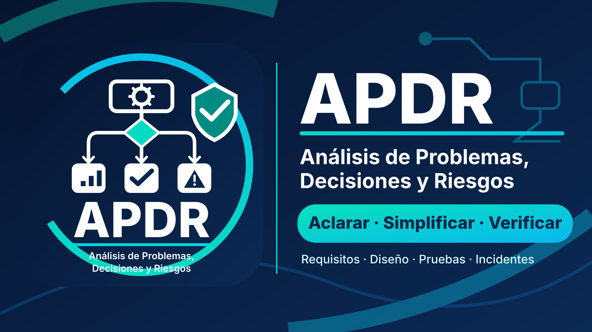
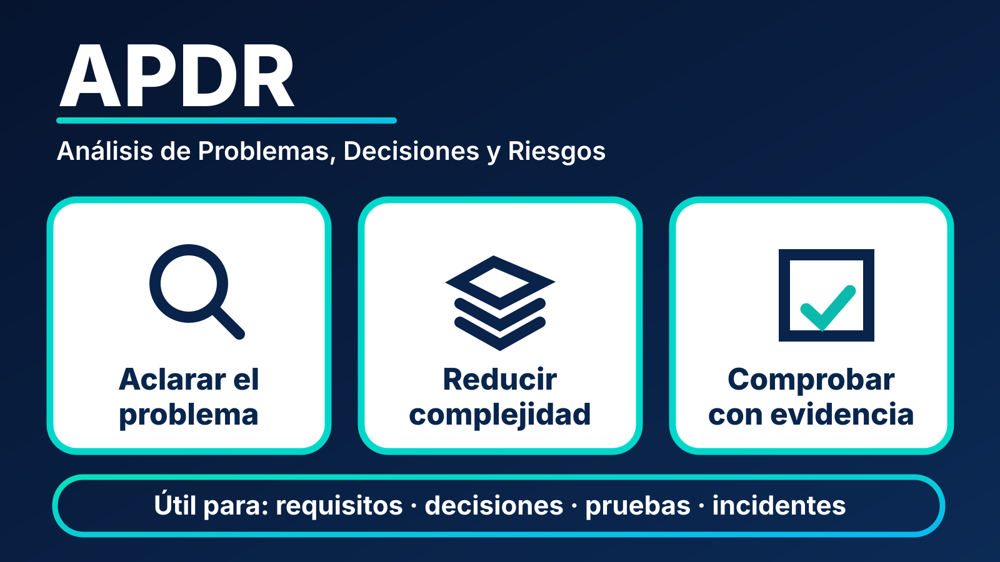

# APDR — Análisis de Problemas, Decisiones y Riesgos

Ayuda a resolver problemas en cualquier fase del desarrollo, prevenir errores lo antes posible y simplificar soluciones sin perder valor.

**Skill:** `apdr` · **Autor:** Cuyedmundo · **Versión:** 2.2.0

[Ver y compartir APDR en Skills.sh](https://www.skills.sh/cuyedmundo/apdr/apdr) · [Leer la skill](skills/apdr/SKILL.md) · [Kit visual oficial y control de versiones](BRAND.md)



<div align="center">

**Aclarar · Simplificar · Verificar**

[Instalar](#instalar-y-usar) · [Casos de uso](#cuándo-usarla-y-qué-esperar) · [Documentación](skills/apdr/SKILL.md) · [Skills.sh](https://www.skills.sh/cuyedmundo/apdr/apdr)

</div>



> **Identidad visual:** [logotipo](skills/apdr/assets/apdr-logo.svg) · [banner](skills/apdr/assets/apdr-banner.svg) · [imagen explicativa](skills/apdr/assets/apdr-showcase.svg). Los recursos pertenecen a APDR y se publican bajo [CC BY-NC-SA 4.0](LICENSE).

## Instalar y usar

### Codex o Claude Code

Necesitas Node.js 22.20 o posterior. Desde la carpeta de tu proyecto, ejecuta:

```bash
npx skills add cuyedmundo/apdr --skill apdr
```

Selecciona el agente donde la usarás. Añade `-g` para instalarla para todos tus proyectos. Después, **en el chat del agente, no en la terminal**, escribe:

**Codex**
```text
$apdr Analiza este problema en su fase actual y propone cómo resolverlo, verificar la solución y prevenir que se repita: [pega aquí el contexto]
```

**Claude Code**
```text
/apdr Analiza este problema en su fase actual y propone cómo resolverlo, verificar la solución y prevenir que se repita: [pega aquí el contexto]
```

También puedes adjuntar documentos, código, resultados de pruebas o reportes de incidentes sin información confidencial. No necesitas reunirlos todos ni repetir la metodología: está dentro de la skill.

### ChatGPT

La instalación anterior es para agentes locales: **no instala APDR en tu cuenta de ChatGPT**.

En una cuenta que tenga habilitadas las Skills, entra a **Plugins → Skills → Create → Upload from your computer** e importa la skill. Para preparar el archivo, descarga este repositorio con **Code → Download ZIP**, extráelo y comprime únicamente la carpeta `skills/apdr` como `apdr.zip`. El ZIP debe contener `apdr/SKILL.md` junto con su licencia, metadatos e imagen.

Después de instalarla, escribe `@`, busca **APDR** y selecciónala en el menú. Añade:

> Analiza este problema en su fase actual y propone cómo resolverlo, verificar la solución y prevenir que se repita.

Si APDR no aparece, revisa que esté instalada y habilitada en esa cuenta. Su disponibilidad depende de la cuenta y de las políticas del espacio de trabajo.

Sin instalación, puedes descargar [SKILL.md](skills/apdr/SKILL.md), adjuntarlo a un chat y pedir «Aplica esta guía a este problema». Eso solo aporta la guía a esa conversación; no registra una skill ni crea un comando.

## Cuándo usarla y qué esperar

APDR sirve en **requisitos, diseño, desarrollo, pruebas, producción y mantenimiento**. Resuelve desde la fase actual: no exige volver al inicio ni aplica el mismo procedimiento a todos los casos.

| Contexto | Ejemplo de petición |
|---|---|
| Requisitos o diseño | «Revisa esta propuesta: ¿qué problema resuelve, qué podemos simplificar sin perder valor y qué conviene comprobar antes de implementarla?» |
| Desarrollo o pruebas | «Esta prueba falla después del cambio. Contrasta las causas posibles y define cómo verificar la corrección y las regresiones.» |
| Producción o mantenimiento | «Hay cobros duplicados y usuarios afectados. Ayúdame a contener el impacto, investigar la causa y evitar que vuelva a ocurrir.» |

Recibirás conclusiones, alternativas y comprobaciones proporcionales al caso, separando lo documentado, observado, inferido, propuesto y pendiente. Ante un incidente se distinguen contención, corrección y prevención de recurrencias. La skill no impone informes largos, inventa resultados ni autoriza por sí sola cambios o reembolsos.

Si el análisis es extenso o reúne varios hallazgos, APDR abre con un **TL;DR** (resumen breve) cuando el formato pedido lo permite. En respuestas breves, da la conclusión en la primera frase.

## Base integrada

**Kidlin + Working Backwards + diseño por sustracción + shift-left testing** gobiernan todo el análisis. Problema, resultado útil, complejidad necesaria y evidencia se retroalimentan desde el inicio del análisis en la fase actual: no son cuatro fases ni recursos opcionales. Los requisitos, riesgos y técnicas de prueba están a su servicio.

Shift-left busca detectar y corregir defectos cuando todavía son requisitos o decisiones: suele requerir menos tiempo, esfuerzo y costo que corregir código desplegado y daños a usuarios. No promete ahorros universales. **La prevención es el enfoque, no una restricción de uso:** lo aprendido durante desarrollo, pruebas o producción debe alimentar decisiones y comprobaciones anteriores a los próximos cambios. Véase [IBM, shift-left testing](https://www.ibm.com/think/topics/shift-left-testing).

APDR no añade herramientas, permisos, memoria ni agentes al entorno. La regla rectora es **resolver desde la fase actual, prevenir lo antes posible y simplificar sin perder valor**.

## Actualizar

```bash
npx skills update apdr
```

Una copia importada manualmente en ChatGPT se actualiza allí, no con el CLI.

## Ayuda y aportaciones

Reporta problemas en [Issues](https://github.com/cuyedmundo/apdr/issues) o propone mejoras por Pull Request siguiendo [CONTRIBUTING.md](CONTRIBUTING.md). El autor es **Cuyedmundo**; el nombre para seleccionar la skill es **APDR**.

La automatización de GitHub Actions informa por separado **Instalación correcta** y **Ficha actualizada**. El segundo resultado requiere comprobar el contenido y la imagen en la ficha pública de Skills.sh.

## Documentación y licencia

[CLI de Skills](https://github.com/vercel-labs/skills) · [ChatGPT y Codex](https://learn.chatgpt.com/docs/build-skills) · [Skills en ChatGPT](https://help.openai.com/en/articles/20001066-skills-in-chatgpt) · [Claude Code](https://code.claude.com/docs/en/skills)

El material original de APDR, incluidas las instrucciones, la documentación, la imagen, la configuración y los scripts, se publica bajo [CC BY-NC-SA 4.0](LICENSE). Las fuentes y dependencias de terceros conservan sus propios términos.
